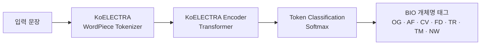

# Context-Aware NER for Neologism Detection

**세대 간 언어 격차 해소를 위한 문맥 인식 개체명 인식 기반 신조어 탐지**

> Junhaeng Lee, HyunYoung Oh, SangWoo Park, Young-myoung Kang\*  
> Dept. of Computer Engineering, Sungkyul University, Anyang, Korea  
> **PlatCon 2025** (Aug. 25–27, 2025)

---

## 📌 Overview

온라인과 SNS에서 신조어가 빠르게 생겨나면서 세대 간 언어 격차가 커지고 있습니다. 기존 **사전·규칙 기반 신조어 탐지**는 미등재어 여부만 보기 때문에, 짧은 수명과 문맥 의존성을 가진 신조어를 제때 잡아내지 못합니다.

이 연구는 신조어를 **하나의 개체명(Neologism, NW)** 으로 정의하고, **KoELECTRA 기반 문맥 인식 NER 모델**이 다른 6개 개체 유형과 함께 신조어를 인식하도록 학습했습니다.

### 핵심 결과

| 데이터 구성 | 신조어(NW) F1 | Macro F1 | Micro F1 |
| :-- | :--: | :--: | :--: |
| **Balanced** | **0.91** | **0.88** | 0.88 |
| Original (실제 불균형 분포) | 0.89 | 0.86 | **0.90** |
| Uniform Small | 0.92 | 0.80 | 0.79 |

- 실제 불균형 분포에서도 신조어 **F1 0.89**를 기록했습니다.
- Balanced 구성에서 **Macro F1 0.88, 신조어 F1 0.91**로 가장 균형 잡힌 성능을 보였습니다.

---

## 🧩 Motivation

- 2025년 국내 설문에서 응답자의 **약 80%** 가 세대 갈등을 심각한 사회 문제로 인식했고, 주요 원인으로 소통의 어려움과 언어 차이를 꼽았습니다 [1].
- 신조어는 방송, 뉴스, 공공 담론에서도 쓰이기 때문에, 신조어 이해도의 격차는 **정보 해석과 정보 접근성의 불평등**으로 이어집니다 [3, 4].

이 연구가 정의한 기존 방법의 두 가지 핵심 한계는 다음과 같습니다.

1. 신조어 생성·확산의 **시간적 변동성과 문맥 의존성**을 반영하지 못한다.
2. **세대 간 언어 비대칭**을 키워 소통을 방해하고 정보 접근성 격차를 고착시킨다.

---

## 🗂 Dataset

[AI Hub 「대규모 웹데이터 기반 한국어 말뭉치」](https://aihub.or.kr/aihubdata/data/view.do?currMenu=115&topMenu=100&aihubDataSe=data&dataSetSn=624) [6]

- 약 **10억 어절** 규모, 사회·문화·과학·경제 등 **17개 주제의 뉴스 기사** 중심
- 7개 개체명 태그가 주석되어 있음

| Tag | Entity | Tag | Entity |
| :-- | :-- | :-- | :-- |
| OG | Organization | TR | Theory / Rule |
| AF | Artifact | TM | Term |
| CV | Civilization | **NW** | **Neologism** |
| FD | Field of Study | | |

### 신조어 정의 (필터링 기준)

원본 NW 태그는 정의가 모호하고 일관성이 부족했습니다. 그래서 신조어를 다음 세 범주로 한정하고 나머지는 제외했습니다 [14].

1. **Compound expressions**: 두 개 이상의 기존 단어가 결합된 표현
2. **Hybrid terms**: 부분 단어 결합이나 형태소 혼성으로 만들어진 용어
3. **Loanwords / Semantic extensions**: 외래어이거나 기존 단어의 의미가 확장된 표현

바뀐 기준에 맞춰 전체 데이터에는 비례 다운샘플링을 적용했습니다.

### 필터링 전후 개체 분포

| Entity | 분포 (%) | 원본 개수 | 필터링 후 |
| :-- | --: | --: | --: |
| OG | 37.8 | 38,143,982 | 3,137,400 |
| AF | 6.1 | 6,153,459 | 522,900 |
| CV | 45.8 | 46,215,902 | 3,801,400 |
| FD | 1.6 | 1,614,704 | 132,800 |
| TR | 1.0 | 1,009,190 | 83,000 |
| TM | 7.6 | 7,669,844 | 630,800 |
| **NW** | **0.1** | **100,919** | **8,331** |

OG와 CV가 80% 이상을 차지하고, 신조어는 **0.1%** 에 불과한 극단적 불균형 데이터입니다.

### 실험용 데이터 구성

| Entity | Balanced | Original | Uniform Small |
| :-- | --: | --: | --: |
| OG | 100,000 | 3,137,400 | 8,331 |
| AF | 100,000 | 522,900 | 8,331 |
| CV | 100,000 | 3,801,400 | 8,331 |
| FD | 100,000 | 132,800 | 8,331 |
| TR | 100,000 | 83,000 | 8,331 |
| TM | 100,000 | 630,800 | 8,331 |
| NW | 8,331 | 8,331 | 8,331 |
| **Total** | **608,331** | **8,316,631** | **58,317** |

- **Balanced**: 과대표 개체를 개체당 최대 100,000개로 제한
- **Original**: 필터링 후의 자연 분포를 그대로 유지
- **Uniform Small**: 모든 개체를 신조어 수(8,331)에 맞춰 동일하게 설정

---

## 🧠 Model

- **Backbone: [KoELECTRA](https://github.com/monologg/KoELECTRA)** [7]
  - ELECTRA [8]는 BERT의 MLM 대신 **Replaced Token Detection(RTD)** 으로 사전학습합니다. Generator가 일부 토큰을 바꾸고, Discriminator가 각 토큰이 원본인지 교체된 것인지 판별합니다.
  - [MASK] 토큰 없이 **모든 토큰에서 손실을 계산**하므로 학습 효율이 높고, 사전학습과 파인튜닝 사이의 불일치도 줄어듭니다.
  - KoELECTRA는 뉴스, 백과사전, 나무위키 등 **약 14GB의 한국어 코퍼스**로 사전학습되어, 뉴스 중심인 본 데이터셋과 도메인이 잘 맞습니다.
- **Tokenizer**: WordPiece 서브워드 토큰화로 사전에 없는 단어(OOV)와 신조어를 처리합니다.
- **Tagging**: BIO scheme

### Training Setup

| 항목 | 값 |
| :-- | :-- |
| Batch size | 32 |
| Max sequence length | 128 |
| Learning rate | 2e-5 |
| Optimizer | AdamW |
| Dropout | 0.1 |
| Max epochs | 100 |
| Early stopping | validation loss 기준, patience 3 |
| Data split | train / val / test = 80 / 10 / 10 (층화 샘플링) |
| Metric | Precision, Recall, F1 (Micro / Macro) |

---

## 📊 Results

### 개체 유형별 F1-score

| Entity | Balanced | Original | Uniform Small |
| :-- | :--: | :--: | :--: |
| OG | 0.88 | 0.91 | 0.77 |
| AF | 0.84 | 0.81 | 0.70 |
| CV | 0.90 | **0.92** | 0.82 |
| FD | **0.92** | 0.87 | 0.86 |
| TR | 0.85 | 0.76 | 0.81 |
| TM | 0.85 | 0.83 | 0.74 |
| **NW** | **0.91** | **0.89** | **0.92** |
| Micro Avg | 0.88 | **0.90** | 0.79 |
| Macro Avg | **0.88** | 0.86 | 0.80 |

### 분석

- **Original**: 데이터가 많은 CV(0.92)와 OG(0.91)는 성능이 높았지만, 희소한 TR은 0.76에 그쳤습니다. 고빈도 개체의 높은 성능이 **인식 공정성**을 희생한 결과입니다.
- **Balanced**: 고자원 개체와 저자원 개체가 모두 비슷한 수준의 F1을 기록했습니다. 클래스 불균형을 완화하는 것이 전체 견고성을 높이는 데 효과적이었습니다.
- **Uniform Small**: OG(0.77), AF(0.70), TM(0.74)이 크게 떨어졌습니다. 데이터 양이 인식 성능에 중요하다는 뜻입니다. 이 구성에서 NW가 기록한 최고치 0.92는 일반화 성능이 좋아졌다기보다 **데이터 다양성이 줄어든 효과**일 가능성이 큽니다.

---

## ✅ Conclusion & Future Work

- 사전·규칙 기반으로는 다루기 어려웠던 신조어를 **문맥 기반으로 견고하게 탐지**하는 NER 모델을 제안했습니다.
- 여러 개체 유형에서 안정적인 성능을 보여, 다중 개체 인식 환경에서도 실용적으로 쓸 수 있음을 확인했습니다.

**Future Work**
- 신조어가 가장 활발하게 등장하는 **비공식 언어, 대화체, 구어체**(SNS, 온라인 커뮤니티)로 확장
- **도메인 적응, 지속학습(continual learning), 준지도학습**으로 저자원 개체의 일반화 성능 향상
- 탐지한 신조어에 **세대별 설명이나 대체 표현을 제공**하는 응용으로 연결

---

## 👥 Authors

| 이름 | 역할 |
| :-- | :-- |
| Junhaeng Lee | Sungkyul Univ., Computer Engineering |
| HyunYoung Oh | Sungkyul Univ., Computer Engineering |
| SangWoo Park | Sungkyul Univ., Computer Engineering |
| Young-myoung Kang\* | Assistant Professor, Sungkyul Univ. (Corresponding author) |

---

## 📚 References

1. Korea Research, "2025 Generation Perception and Intergenerational Conflict Survey: Weekly Report No. 322-1," HR Consulting Opinion, 2025. [Link](https://hrcopinion.co.kr/en/archives/32460)
2. Z.R. Sultanova, "Neologisms in the Modern World: Language That Changes Reality," *Pedagogik Tadqiqotlar Jurnali*, vol. 3, no. 1, pp. 188–193, 2025.
3. I. Aziza and Z. Aktamova, "Modern Neologisms and Their Impact on Society," *IJMRGE*, vol. 6, no. 2, pp. 491–494, 2025.
4. S.T. Vacalares et al., "The Intelligibility of Internet Slangs Between Millennials and Gen Zers: A Comparative Study," *IJSRA*, vol. 9, no. 1, pp. 400–409, 2023.
5. K.I. Nam, "New Words of 2019 Investigation," National Institute of Korean Language, 2019.
6. National Information Society Agency, "AI Hub: Large Web Data-Based Korean Corpus Dataset," 2022.
7. J. Park, "KoELECTRA: Pretrained ELECTRA Model for Korean," GitHub, 2020.
8. K. Clark et al., "ELECTRA: Pre-Training Text Encoders as Discriminators Rather Than Generators," arXiv:2003.10555, 2020.
9. J.H. Kim, H.C. Kim, and Y.S. Choi, "Feature Generation of Dictionary for Named-Entity Recognition Based on Machine Learning," *Journal of Information Management*, vol. 41, no. 2, 2010.
10. V. Yadav and S. Bethard, "A Survey on Recent Advances in Named Entity Recognition From Deep Learning Models," arXiv:1910.11470, 2019.
11. J. Li et al., "A Survey on Deep Learning for Named Entity Recognition," *IEEE TKDE*, vol. 34, no. 1, pp. 50–70, 2022.
12. Z. Huang, W. Xu, and K. Yu, "Bidirectional LSTM-CRF Models for Sequence Tagging," arXiv:1508.01991, 2015.
13. M. Munnangi, "A Brief History of Named Entity Recognition," arXiv:2411.05057, 2024.
14. Y. Li, "Sources of English Neologisms," *Linguistics and Education*, vol. 42, no. 1, pp. 210–215, 2024.
15. J. Devlin et al., "BERT: Pre-Training of Deep Bidirectional Transformers for Language Understanding," arXiv:1810.04805, 2018.
16. A. Mansouri, L.S. Affendey, and A. Mamat, "Named Entity Recognition Approaches," *IJCSNS*, vol. 8, no. 2, pp. 339–344, 2008.
